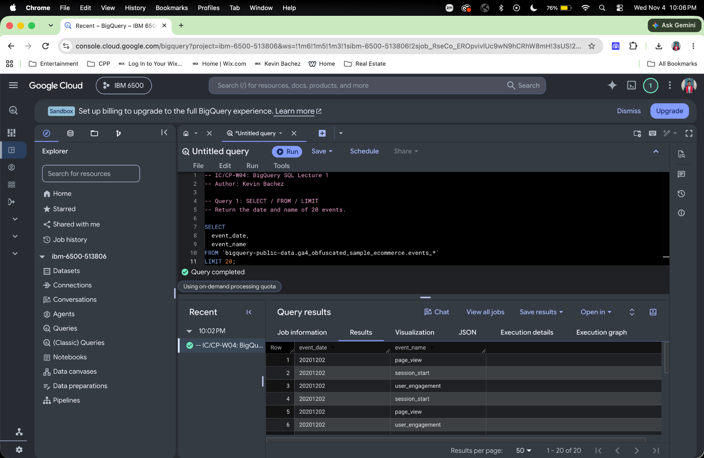
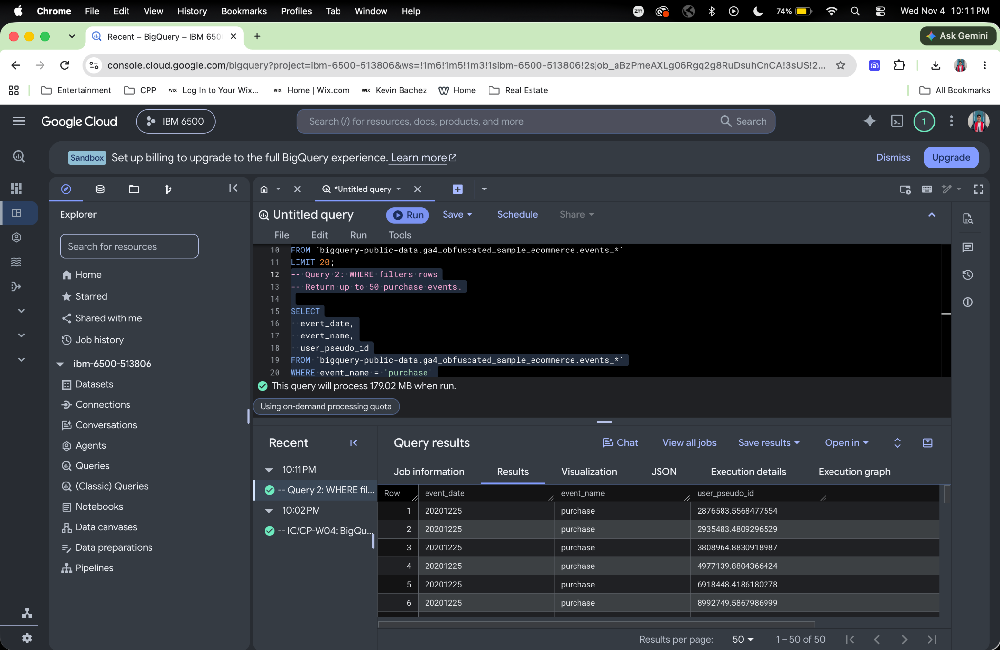
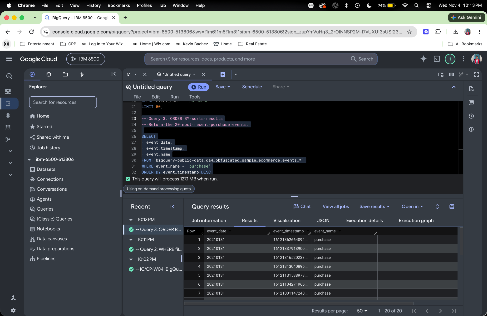
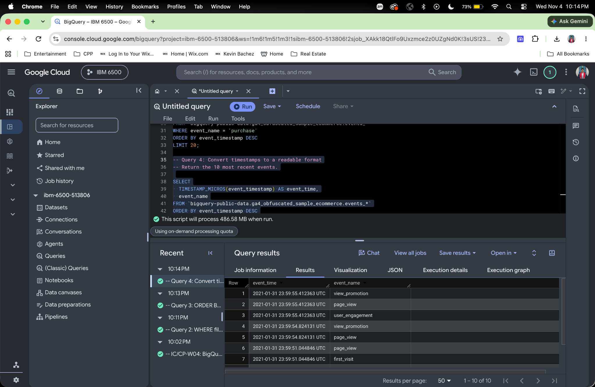
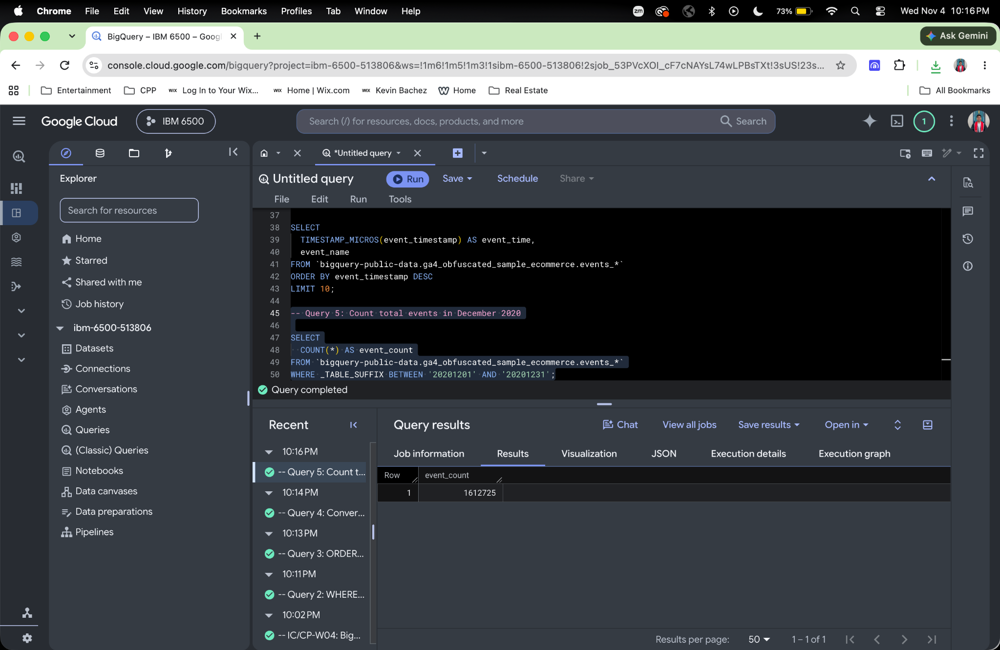
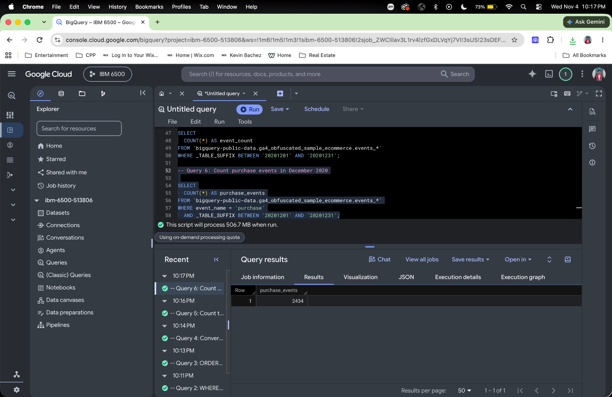
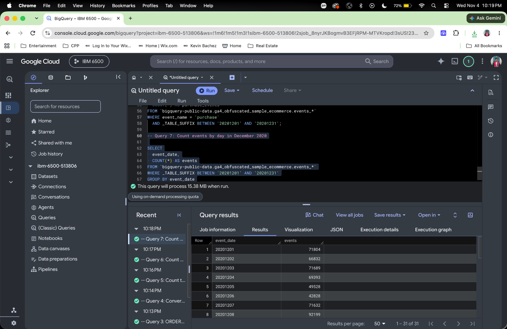
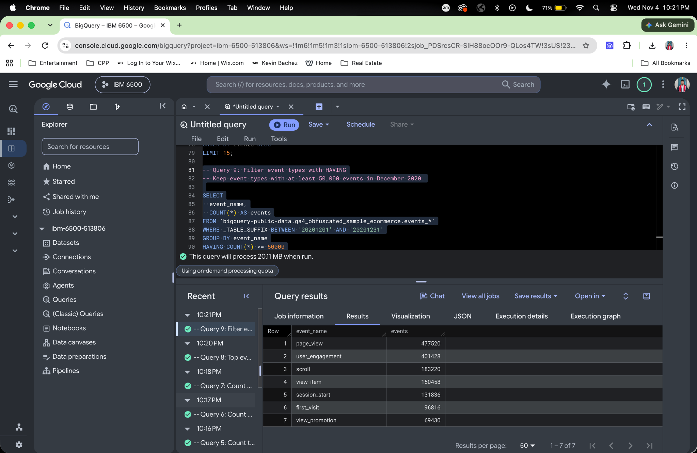
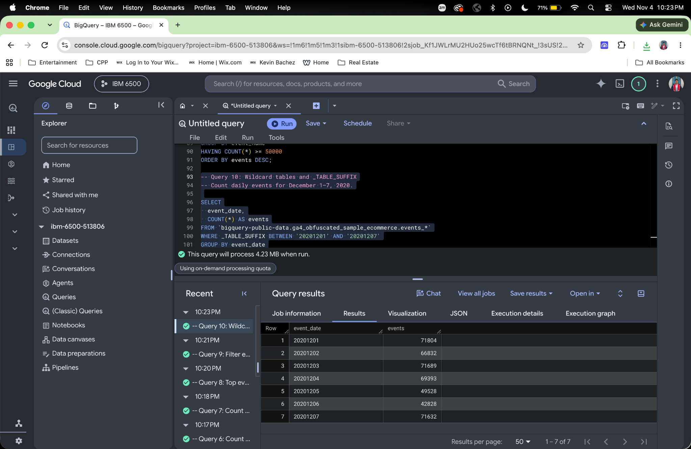

# Introduction

This notebook documents the queries from Lecture 1 using the public GA4 sample ecommerce dataset. Each section includes SQL code, an explanation, and a screenshot of the query results.

# SELECT / FROM / LIMIT

## Query 1: Select Event Dates and Names

``` sql
-- Query 1: SELECT / FROM / LIMIT
-- Return the date and name of 20 events.

SELECT
  event_date,
  event_name
FROM `bigquery-public-data.ga4_obfuscated_sample_ecommerce.events_*`
LIMIT 20;
```

## Explanation

This query selects the event_date and event_name columns from the GA4 sample ecommerce tables. LIMIT 20 restricts the output to 20 rows. Without ORDER BY, the results have no guaranteed order.

## Results

The query ran successfully and returned 20 rows. The output includes events such as page_view, session_start, and user_engagement. The date 20201202 represents December 2, 2020.



# WHERE Filters Rows

## Query 2: Select Purchase Events

```sql
-- Query 2: WHERE filters rows
-- Return up to 50 purchase events.

SELECT
  event_date,
  event_name,
  user_pseudo_id
FROM `bigquery-public-data.ga4_obfuscated_sample_ecommerce.events_*`
WHERE event_name = 'purchase'
LIMIT 50;
```

## Explanation

This query selects the event date, event name, and pseudonymous user identifier. WHERE keeps only events named purchase, and LIMIT 50 restricts the output to 50 rows. Each row represents a purchase event, rather than necessarily a different user.

## Results

The query ran successfully and returned 50 purchase events. The visible rows show the date 20201225, which represents December 25, 2020.



# ORDER BY Sorts Results

## Query 3: Most Recent Purchase Events

```sql
-- Query 3: ORDER BY sorts results
-- Return the 20 most recent purchase events.

SELECT
  event_date,
  event_timestamp,
  event_name
FROM `bigquery-public-data.ga4_obfuscated_sample_ecommerce.events_*`
WHERE event_name = 'purchase'
ORDER BY event_timestamp DESC
LIMIT 20;
```

## Explanation

This query selects the date, timestamp, and name of purchase events. ORDER BY event_timestamp DESC sorts events from newest to oldest, and LIMIT 20 returns the 20 most recent purchase events in the dataset. GA4 stores event_timestamp as microseconds since January 1, 1970 UTC.

## Results

The query ran successfully and returned 20 purchase events. The visible rows have the date 20210131, which represents January 31, 2021. Their timestamps decrease down the results, confirming the descending sort.



## Query 4: Readable Event Timestamps

```sql
-- Query 4: Convert timestamps to a readable format
-- Return the 10 most recent events.

SELECT
  TIMESTAMP_MICROS(event_timestamp) AS event_time,
  event_name
FROM `bigquery-public-data.ga4_obfuscated_sample_ecommerce.events_*`
ORDER BY event_timestamp DESC
LIMIT 10;
```

## Explanation

TIMESTAMP_MICROS converts the numeric GA4 timestamp into a readable date and time. AS event_time names the converted column. ORDER BY event_timestamp DESC sorts events from newest to oldest, and LIMIT 10 returns 10 events. No WHERE filter is applied, so all event types are eligible.

## Results

The query ran successfully and returned 10 events with timestamps displayed in UTC. The latest displayed timestamp is January 31, 2021, at 23:59:55.412363 UTC. Visible event types include view_promotion, page_view, user_engagement, and first_visit.



# Aggregate Functions

## Query 5: Count Total Events in December 2020

```sql
-- Query 5: Count total events in December 2020

SELECT
  COUNT(*) AS event_count
FROM `bigquery-public-data.ga4_obfuscated_sample_ecommerce.events_*`
WHERE _TABLE_SUFFIX BETWEEN '20201201' AND '20201231';
```

## Explanation

COUNT(*) counts all event rows in the selected tables. AS event_count names the result column. The _TABLE_SUFFIX condition restricts the query to daily tables from December 1 through December 31, 2020, inclusive. Without GROUP BY, the query returns one total.

## Results

The query ran successfully and returned one row. The dataset contains 1,612,725 events during December 2020. This counts events, rather than unique users or sessions.



## Query 6: Count Purchase Events in December 2020

```sql
-- Query 6: Count purchase events in December 2020

SELECT
  COUNT(*) AS purchase_events
FROM `bigquery-public-data.ga4_obfuscated_sample_ecommerce.events_*`
WHERE event_name = 'purchase'
  AND _TABLE_SUFFIX BETWEEN '20201201' AND '20201231';
```

## Explanation

WHERE filters the data to purchase events, and AND adds the requirement that the daily tables fall between December 1 and December 31, 2020, inclusive. COUNT(*) counts the matching event rows. AS purchase_events names the output column.

## Results

The query ran successfully and returned one row containing 2,434 purchase events for December 2020. This represents the number of purchase events, rather than the number of unique customers.



# GROUP BY Controls the Grain

## Query 7: Count Events by Day

```sql
-- Query 7: Count events by day in December 2020

SELECT
  event_date,
  COUNT(*) AS events
FROM `bigquery-public-data.ga4_obfuscated_sample_ecommerce.events_*`
WHERE _TABLE_SUFFIX BETWEEN '20201201' AND '20201231'
GROUP BY event_date
ORDER BY event_date;
```

## Explanation

The _TABLE_SUFFIX filter selects the daily tables for December 2020. GROUP BY event_date combines events with the same date, so each output row represents one day. COUNT(*) calculates the number of events for each day. ORDER BY event_date sorts the dates from earliest to latest.

## Results

The query ran successfully and returned 31 rows, one for each day in December 2020. December 1 had 71,804 events, December 2 had 66,832 events, and December 3 had 71,689 events. These results show how event activity varies by day.



## Query 8: Top Event Types in December 2020

```sql
-- Query 8: Top event types in December 2020

SELECT
  event_name,
  COUNT(*) AS events
FROM `bigquery-public-data.ga4_obfuscated_sample_ecommerce.events_*`
WHERE _TABLE_SUFFIX BETWEEN '20201201' AND '20201231'
GROUP BY event_name
ORDER BY events DESC
LIMIT 15;
```

## Explanation

The _TABLE_SUFFIX filter selects December 2020. GROUP BY event_name creates one row for each event type, and COUNT(*) counts its occurrences. ORDER BY events DESC ranks event types from most to least frequent. LIMIT 15 returns the top 15.

## Results

The query ran successfully and returned 15 event types. The most frequent was page_view with 477,520 events, followed by user_engagement with 401,428 and scroll with 183,220.


# HAVING Filters After Grouping

## Query 9: Event Types with at Least 50,000 Events

```sql
-- Query 9: Filter event types with HAVING
-- Keep event types with at least 50,000 events in December 2020.

SELECT
  event_name,
  COUNT(*) AS events
FROM `bigquery-public-data.ga4_obfuscated_sample_ecommerce.events_*`
WHERE _TABLE_SUFFIX BETWEEN '20201201' AND '20201231'
GROUP BY event_name
HAVING COUNT(*) >= 50000
ORDER BY events DESC;
```

## Explanation

WHERE selects the December 2020 daily tables. GROUP BY event_name groups the rows by event type, and COUNT(*) counts each type's occurrences. HAVING keeps only groups with at least 50,000 events. ORDER BY events DESC sorts the remaining groups from highest to lowest count.

WHERE filters rows before aggregation, while HAVING filters groups after aggregation.

## Results

The query ran successfully and returned seven event types with at least 50,000 events each. The results range from page_view with 477,520 events to view_promotion with 69,430 events.



# Wildcard Tables and _TABLE_SUFFIX

## Query 10: Daily Events for December 1–7, 2020

```sql
-- Query 10: Wildcard tables and _TABLE_SUFFIX
-- Count daily events for December 1–7, 2020.

SELECT
  event_date,
  COUNT(*) AS events
FROM `bigquery-public-data.ga4_obfuscated_sample_ecommerce.events_*`
WHERE _TABLE_SUFFIX BETWEEN '20201201' AND '20201207'
GROUP BY event_date
ORDER BY event_date;
```

## Explanation

The wildcard events_* matches multiple daily event tables. _TABLE_SUFFIX restricts the query to tables dated December 1–7, 2020, inclusive. Restricting the tables scanned can reduce query processing and cost. GROUP BY event_date produces one row per day, and COUNT(*) counts that day's events. ORDER BY event_date sorts the results chronologically.

## Results

The query ran successfully and returned seven rows. December 1 had 71,804 events, while December 7 had 71,632 events. Among these seven days, December 1 had the most events and December 6 had the fewest, with 42,828.



# GitHub Links

- [View the published assignment on GitHub Pages](https://kebachez.github.io/IC-CP-W04-BigQuery-SQL-Lecture-1/)
- [View the GitHub repository](https://github.com/kebachez/IC-CP-W04-BigQuery-SQL-Lecture-1.git)